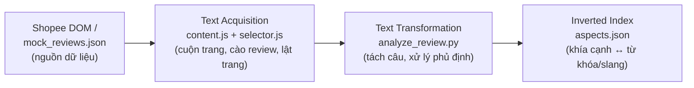
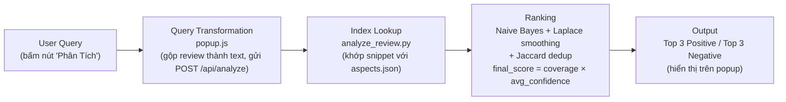

# Shopee Review Summarizer

Chrome Extension (Manifest V3) kết hợp FastAPI Backend, tự động trích xuất đánh giá sản phẩm trên Shopee và tóm tắt **Top 3 Ưu điểm** & **Top 3 Nhược điểm** bằng phương pháp **Aspect-Based Sentiment Analysis (ABSA)** rule-based (từ điển + xử lý phủ định + Naive Bayes Laplace smoothing).

---

## 1. Kiến trúc hệ thống

Đúng theo mô hình kinh điển của một search/retrieval engine (Chương 2 – Architecture of a Search Engine): hệ thống tách thành **2 pipeline hoạt động độc lập** — **Indexing Pipeline** (chuẩn bị dữ liệu, chạy khi có review mới) và **Query Pipeline** (xử lý mỗi lần người dùng bấm "Phân Tích"). Đây cũng là nguyên lý "indexing process và query process làm việc độc lập" đã học.

### Indexing Pipeline



### Query Pipeline



### Mô tả từng tầng

| Pipeline | Tầng                     | Module                                   | Nhiệm vụ                                                                                                                                                    |
| -------- | ------------------------ | ---------------------------------------- | ----------------------------------------------------------------------------------------------------------------------------------------------------------- |
| Indexing | **Text Acquisition**     | `content.js`, `selector.js`              | Cuộn trang, trích xuất review thô từ DOM Shopee (sao, ngày, phân loại, nội dung), tự động lật trang kế tiếp                                                 |
| Indexing | **Text Transformation**  | `analyze_review.py` → `split_snippets()` | Tách review thành các mệnh đề nhỏ theo dấu câu và liên từ đối lập (_nhưng, tuy nhiên_); nhận diện và đảo cực tính câu phủ định (_"không tốt"_ → tiêu cực)   |
| Indexing | **Inverted Index**       | `aspects.json`                           | Từ điển khía cạnh (giao hàng, đóng gói, chất lượng, giá cả, dịch vụ) và kho từ cảm xúc, bao gồm tiếng lóng Shopee thực tế (_đỉnh chóp, toang, lởm khởm..._) |
| Query    | **Query Transformation** | `popup.js`                               | Gộp `structured` + `freeText` của mỗi review thành 1 chuỗi, đóng gói request gửi backend                                                                    |
| Query    | **Index Lookup**         | `analyze_review.py`                      | Khớp từng snippet với từ điển khía cạnh đã lập ở Indexing Pipeline                                                                                          |
| Query    | **Ranking**              | `analyze_review.py`                      | Khử trùng lặp ý kiến tương tự (Jaccard trigram), tính độ tin cậy bằng Laplace smoothing, xếp hạng theo `coverage × avg_confidence`                          |
| Query    | **Output**               | `main.py`, popup UI                      | Trả Top 3 mỗi loại qua API, popup hiển thị khía cạnh, câu trích dẫn, số lượt nhắc, độ tin cậy                                                               |

> **Evaluation** (`eval_check.py`) nằm ngoài 2 pipeline trên — chạy riêng, độc lập, để đối chiếu benchmark và kiểm tra độ chính xác của Indexing + Query Pipeline.

---

## 2. Hướng dẫn khởi chạy

### Backend

```bash
# Kích hoạt virtualenv
.venv\Scripts\activate          # Windows
# source .venv/bin/activate     # macOS/Linux

# Cài thư viện
pip install -r backend/requirements.txt

# Chạy server
python backend/main.py
```

Server chạy tại `http://127.0.0.1:8000`. Swagger UI (test API trực tiếp, không cần `curl`): `http://127.0.0.1:8000/docs`.

### Chrome Extension


1. Vào `chrome://extensions/`, bật **Developer mode** ở góc trên bên phải _(mũi tên 1)_.
2. Bấm **Load unpacked** ở góc trên bên trái _(mũi tên 2)_ → chọn thư mục `extensions/`.
3. Mở 1 trang sản phẩm trên `https://shopee.vn/` → bấm icon extension → **Phân Tích**.

> Nếu không cào được review thật (trang chưa load kịp, hoặc bị chặn), extension tự động dùng `mock_reviews.json` để chạy thử nghiệm.

---

## 3. API

### `POST /api/analyze`

**Request:**

```json
{
  "product_url": "https://shopee.vn/...",
  "reviews": [
    "giao hàng nhanh, đóng gói cẩn thận",
    "chất lượng không tốt, giao chậm"
  ]
}
```

**Response:**

```json
{
  "total_reviews": 2,
  "top_positive": [
    {
      "aspect": "giao hàng",
      "example": "giao hàng nhanh",
      "mentions": 1,
      "confidence": 0.8
    }
  ],
  "top_negative": [
    {
      "aspect": "chất lượng",
      "example": "chất lượng không tốt",
      "mentions": 1,
      "confidence": 0.75
    },
    {
      "aspect": "giao hàng",
      "example": "giao chậm",
      "mentions": 1,
      "confidence": 0.7
    }
  ]
}
```

---

## 4. Đánh giá độ chính xác (Evaluation)

```bash
python backend/eval_check.py
```

Bộ kiểm thử gồm:

- **24 ca benchmark** phân loại cảm xúc theo khía cạnh, lấy từ review thực tế có chứa tiếng lóng Shopee.
- **Ca kiểm thử Dedup** — xác minh các review nội dung tương tự được gom nhóm đúng.
- **Ca kiểm thử Negation Flip** — xác minh câu phủ định ("không tốt", "chẳng đẹp") bị đảo cực tính đúng chiều.
- **Ca kiểm thử Ranking Score** — xác thực `final_score` và `confidence` hợp lệ.

---
